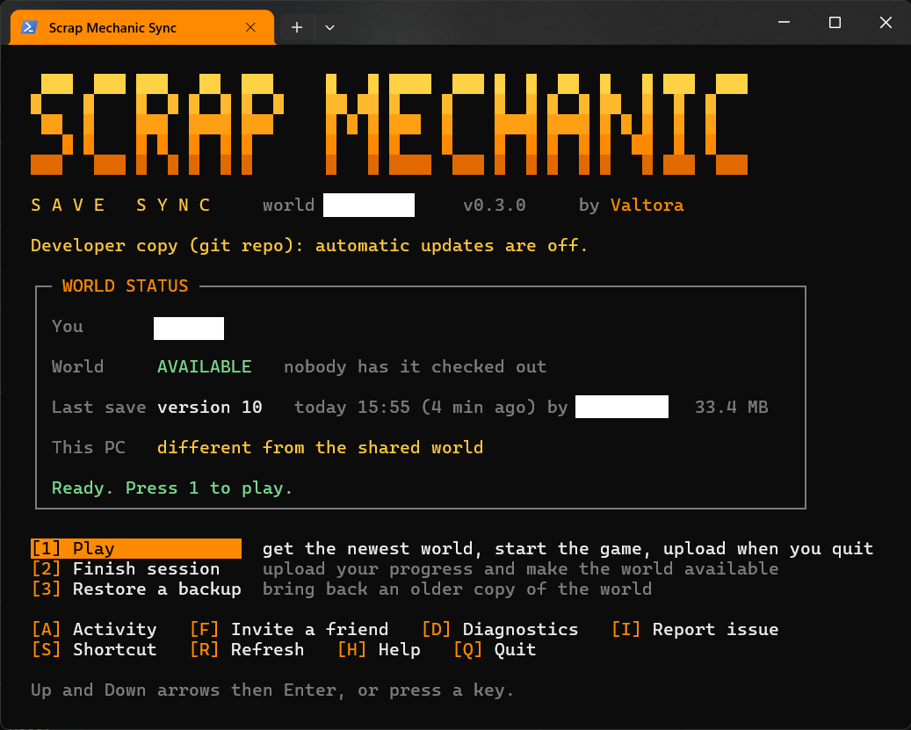

# Scrap Mechanic Sync

Share one Scrap Mechanic Survival world with friends, with no dedicated server and no
sending save files to each other.

## What it is

A small Windows tool that keeps your world in online storage and passes it between
players like a library book. One player checks the world out, the game opens straight into
it, and when they quit the tool uploads their progress for the next player.

- **Two copies never go out of sync.** Only the player who has the world can play and upload.
- **Play together too.** If a friend already has the world, one key joins their game.
- **Backups at every step.** The last 5 uploads and the last 10 local copies can be restored.
- **Nothing to install.** One PowerShell script with a text menu. It updates itself.

## Quick start

You need Windows 10 or 11 and Scrap Mechanic on Steam. One person in the group, the host,
also needs a Cloudflare account for the storage. Cloudflare asks for a payment card when
its storage is switched on, but a shared world stays far inside the free allowance.

1. Download [Scrap-Mechanic-Sync.zip](https://github.com/Valtora/sm-sync/releases/latest/download/Scrap-Mechanic-Sync.zip),
   right-click it and choose **Extract All**.
2. Open the folder and double-click **Scrap Mechanic Sync**.
3. Choose your route on the welcome screen:
   - **Starting a shared world:** press **2**. The tool walks you through creating the
     storage, uploads your world and gives you an invite to send. About 10 minutes.
   - **Joining a friend's world:** copy the invite message they sent you and press **1**.
4. From then on, start the game from the tool. Press **1** to play and quit the game when
   you are done. The tool does the rest.

An invite code is the key to your world, so send it privately.

## Guides

| | |
| --- | --- |
| [Setup guide](docs/SETUP.md) | Every setup step for hosts and friends, and what to do when the connection test fails |
| [Everyday use](docs/USAGE.md) | The menu, playing at the same time, backups and troubleshooting |
| [Safety and privacy](docs/SAFETY.md) | What the tool does on your PC, automatic updates, and what a report contains |
| [Development notes](docs/DEVELOPMENT.md) | Storage layout, tests and releases |

Found a fault? Press **I** in the tool's menu, or [open an issue](https://github.com/Valtora/sm-sync/issues/new/choose).
Never post an invite code or your settings file.

## Disclaimer

Scrap Mechanic Sync is an unofficial, fan-made tool. It is not affiliated with, endorsed
by or supported by Axolot Games, the developer and publisher of Scrap Mechanic. Scrap
Mechanic is a trademark of its owner. Use the tool at your own risk and keep your own
backups of worlds you care about.

## Credits

Inspired by [u/Gloryboy811](https://www.reddit.com/user/Gloryboy811) on Reddit, who
described a similar tool of their own.

---

If this saved you some hassle, you can [buy me a coffee](https://ko-fi.com/valtora).
