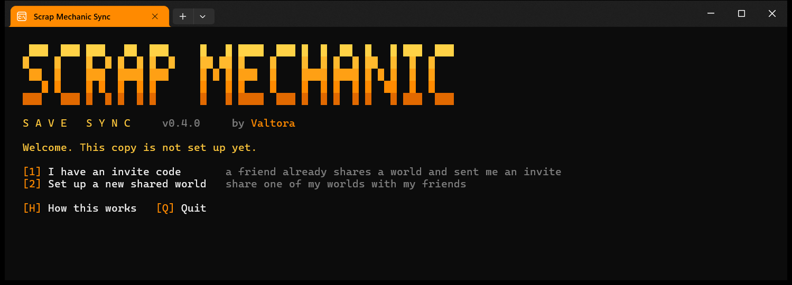
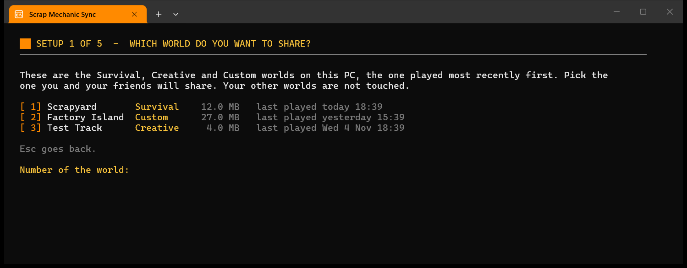
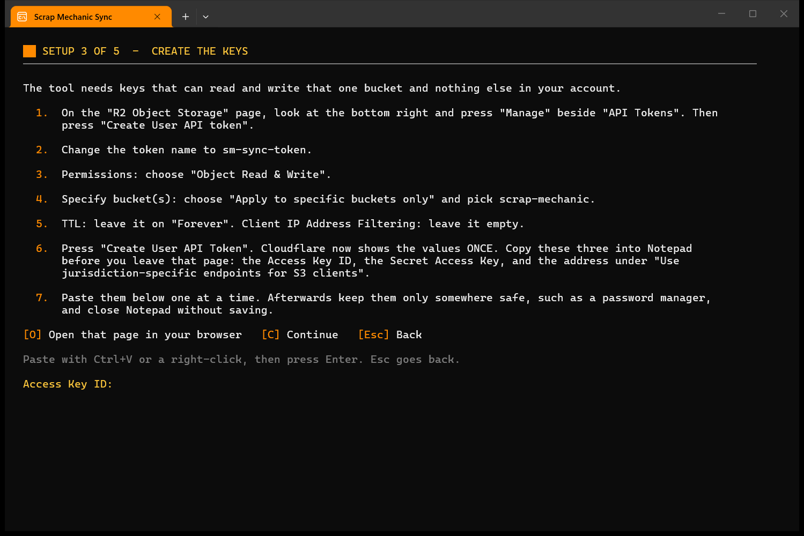
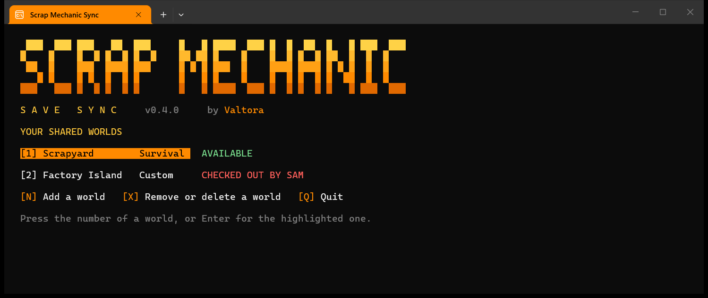

# Setup guide

There are two routes. One person in each group is the **host**: they create the storage
and invite the others. Everyone else is a **friend** and needs only an invite.

- [Download and first start](#download-and-first-start) (everyone)
- [Host: share a world](#host-share-a-world)
- [Friend: join with an invite](#friend-join-with-an-invite)
- [More than one world](#more-than-one-world)
- [When the connection test fails](#when-the-connection-test-fails)
- [Changing things later](#changing-things-later)

Every setup screen can be left with **Esc**. It goes back one step, and from the first
step it asks whether to leave the setup. Nothing is saved until the connection test
passes.

## Download and first start

1. Download [Scrap-Mechanic-Sync.zip](https://github.com/Valtora/sm-sync/releases/latest/download/Scrap-Mechanic-Sync.zip).
2. Right-click the zip and choose **Extract All**. Put the folder somewhere permanent,
   such as Documents. Keep the files together.
3. Open the folder and double-click **Scrap Mechanic Sync**.

Windows may show one of two warnings, because the file came from the internet:

- A blue box, "Windows protected your PC": click **More info**, then **Run anyway**.
- "Open File - Security Warning": click **Run**.

A black and orange window opens. If Windows Terminal is installed the tool uses it,
otherwise it uses the classic console. Both work.

## Host: share a world

You need a world that already exists on your PC, and about 10 minutes. It can be a
Survival, Creative or Custom world. Press
**2** on the welcome screen. The tool shows these same steps as you go.

### Step 1: pick the world

The tool lists the Survival, Creative and Custom worlds on your PC, most recently played
first, with the type of each. Type the number of the one to share and press Enter. Your
other worlds are never touched.

If the world uses Steam Workshop mods, which every Custom game does, your friends need
the same mods. The tool reads them from the world and lists their Workshop links in the
invite. See [Mods](USAGE.md#mods).

If the list is empty, start Scrap Mechanic, create a world, quit the game and
press **R**.

### Step 2: create the storage

The world lives in Cloudflare R2. Press **O** and the tool opens the right page.

1. Sign in at [dash.cloudflare.com](https://dash.cloudflare.com), or create a free account.
2. In the left-hand menu open **R2 Object Storage**. The first time, Cloudflare asks for a
   payment card to switch R2 on. The free allowance is 10 GB of storage. A world is a few
   megabytes and the tool keeps 5 versions, so you stay far below it.
3. Press **Create bucket**. Name it `scrap-mechanic` (any name works), leave the other
   settings alone, and create it.
4. Back in the tool, press **C** and type the bucket name, or press Enter if you used
   `scrap-mechanic`.

### Step 3: create the keys

The keys let the tool read and write that one bucket and nothing else in your account.
Press **O** and the tool opens the token page.

1. On the **R2 Object Storage** page, look at the bottom right and press **Manage** beside
   **API Tokens**. Then press **Create User API token**.
2. Change the token name to `sm-sync-token`.
3. Permissions: choose **Object Read & Write**.
4. Specify bucket(s): choose **Apply to specific buckets only** and pick your bucket.
5. TTL: leave it on **Forever**. If you set an expiry, every copy stops syncing on that
   day until you create a new token and send new invites.
6. Client IP Address Filtering: leave it empty.
7. Press **Create User API Token**. Cloudflare shows the values **once**. Copy these three
   into Notepad before you leave the page:

| Value | Looks like |
| --- | --- |
| Access Key ID | 32 letters and digits |
| Secret Access Key | 64 letters and digits |
| The address under "Use jurisdiction-specific endpoints for S3 clients" | Starts with `https://` and ends in `r2.cloudflarestorage.com` |

You do not need the "Token value".

8. In the tool press **C** and paste the three values in that order, each followed by
   Enter. Paste with Ctrl+V or a right-click. The secret shows as stars.

If an entry is not right, the tool says what is wrong with it, for example that you
pasted the secret into the Access Key ID box, and asks again.

Afterwards, keep the values only somewhere safe such as a password manager, and close
Notepad without saving. The tool stores them in its settings file, and an invite contains
them too.

### Step 4: test

The tool connects, writes a small test object and deletes it. Green lines mean the keys
work. If anything is red, see [When the connection test fails](#when-the-connection-test-fails).

The settings are saved in `sm-sync.config.json` next to the tool. That file holds the
keys. Treat it like a password and never post it.

### Step 5: upload and invite

1. Type your name. Your friends see it when you have the world.
2. Confirm the upload of your world as the starting point. Scrap Mechanic must be closed.
3. The tool shows the **invite**. Press **Ctrl+C** to copy the whole invite message, which
   holds the download link, the steps and the code, and paste it into a private message
   to each friend. Press **T** to save the same message as a text file next to the tool.

**The invite is the key to the world.** Anyone who has it can download, replace or delete
the shared world. Do not post it in a public channel and do not share a screenshot of it.
Press **F** in the menu to show it again.

## Friend: join with an invite

1. Download and start the tool as described [above](#download-and-first-start).
2. Copy the whole message your friend sent you.
3. Press **1** on the welcome screen. The tool finds the code in your clipboard. If it
   does not, paste the message when asked and press Enter.
4. Type your name. Use a different name from your friends.
5. Say yes to the desktop shortcut, **Scrap Mechanic - Sync**, and from now on start the
   game with it.

If the invite lists Workshop mods, open each link, press **Subscribe** and let Steam
download it before you press Play. The tool will not start a world whose mods are missing.

You do not need a Cloudflare account.

## More than one world

One copy of the tool can hold up to nine shared worlds, from the same storage or from
different ones. Press **M** in the menu to open **Worlds**.

- **N** adds a world, with an invite or by sharing one of your own.
- A host who already has storage set up is offered the same storage for the next world,
  which skips the Cloudflare steps. Friends invited to either world then hold the same
  keys, so someone technical could reach both. Choose new storage to keep two groups
  fully apart.
- One PC holds one shared world per name, whatever its type. To share a Creative world
  with the same name as a shared Survival world, rename it in the game first.
- With two or more worlds, the tool starts on the Worlds list. Each row shows whether that
  world is available or who has it.
- **X** removes a world from this PC, or deletes it for everyone. See
  [Everyday use](USAGE.md#worlds).

## When the connection test fails

| The tool says | Cause | Fix |
| --- | --- | --- |
| The storage rejected the access keys | The token is read-only, or was created for a different bucket | Press **K** and paste again. Check the token's permission is **Object Read & Write** and that it applies to this bucket. |
| The storage has no bucket named ... | The name typed in step 2 differs from the bucket's real name | Press **B** and type the name exactly as Cloudflare shows it. |
| The clock on this PC is wrong | The storage refuses requests whose time is more than a few minutes out | Windows Settings, Time and language, Date and time, **Sync now**. Then press **T**. |
| Could not reach the online storage | No internet, or a wrong address | Check the address ends in `r2.cloudflarestorage.com`. Press **K** to enter it again. |

If you closed the Cloudflare page before copying the values, delete that token in
Cloudflare and create a new one. The secret cannot be shown a second time.

## Changing things later

- **An invite leaked, or someone should lose access:** in Cloudflare, delete the API token
  and create a new one. In the tool, remove the world from your PC (**M**, **X**), add it
  again as host with the new keys, and send new invites.
- **Turn off automatic updates:** add `"AutoUpdate": false` to `sm-sync.config.json`.
- **Edit the settings by hand:** copy `sm-sync.config.example.json` to
  `sm-sync.config.json` and fill it in. Each entry in `Worlds` may also have `SaveFolder`
  (the folder that holds the world, if the tool cannot find it). Settings for every world
  go at the top level: `BackupsToKeep` (default 10), `OpenWorldDirectly` (`false` starts
  the game at its main menu) and `AutoUpdate`.

The setup accepts Cloudflare R2 keys only. The tool speaks the S3 protocol, so another
S3-compatible storage may work if you write the settings by hand, but only R2 is tested.
