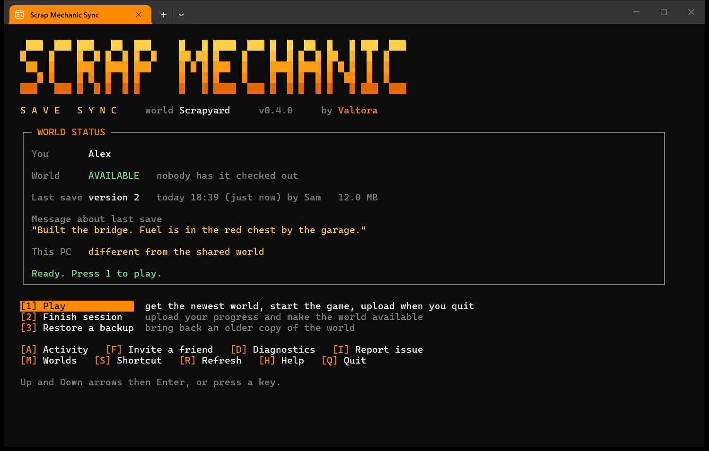
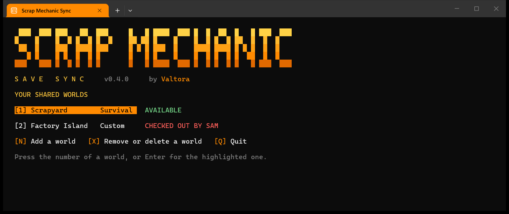

# Everyday use

How to play once the tool is [set up](SETUP.md). The same guide in plain text, for sending
to a friend, is [FRIEND-INSTRUCTIONS.txt](../FRIEND-INSTRUCTIONS.txt).

- [A normal session](#a-normal-session)
- [The menu](#the-menu)
- [Playing at the same time](#playing-at-the-same-time)
- [Worlds](#worlds)
- [Inviting a friend](#inviting-a-friend)
- [Mods](#mods)
- [Backups](#backups)
- [If something looks wrong](#if-something-looks-wrong)

## A normal session

1. Start the tool, not the game. The first run offers a desktop shortcut for this.
2. Look at the status box. **AVAILABLE** means nobody has the world.
3. Press **1**. The tool downloads the newest world, checks it out to you and starts the
   game inside it. Leave the tool's window open.
4. Quit the game when you are done. The tool uploads your progress and the world becomes
   available again.
5. It asks for an optional note for the next player, such as "fuel is in the red chest".

If the game shows its main menu instead of the world, load the world yourself as normal.

## The menu

Move with the up and down arrows and press Enter, or press the key in brackets. Options
that cannot be used right now are greyed out with the reason beside them. The status box
refreshes every 30 seconds.

| Key | Does |
| --- | --- |
| **1** | Play: download the newest world, check it out, start the game, upload on quit |
| **2** | Finish session: upload now, for example after a failed upload |
| **3** | Restore a backup, from this PC or from the online copies |
| **J** | Join the friend who has the world, as a guest in their game |
| **W** | Wait: a Windows notification tells you when the world is available |
| **4** | Force check-out, for when a friend forgot to finish |
| **A** | Activity: who played when, for how long, and their notes |
| **F** | Invite a friend |
| **M** | Worlds: switch, add, remove or delete a shared world |
| **D** | Diagnostics: check the setup and copy a report |
| **I** | Report an issue on GitHub, with the report filled in |
| **S** | Put the **Scrap Mechanic - Sync** shortcut on the desktop |
| **H** | Help |

**J**, **W** and **4** appear only while another player has the world.

**Force check-out** gives you the last uploaded world. Whatever the other player did since
their last upload stays out of the shared world, so ask them first.

## Playing at the same time

One player presses **1** and hosts. The other opens the tool, sees **CHECKED OUT BY** the
host, and presses **J**. The game starts and joins the host, who must already be inside
the world. Only the host has the world checked out and only the host uploads at the end.

If you land on the game's main menu instead, press Shift+Tab, find your friend in the
Steam list and choose **Join Game**.

## Worlds

One copy of the tool can hold up to nine shared worlds. Press **M** to open the list. With
two or more worlds, the tool also starts on it.

Each row shows whether that world is available or who has it. Press a world's number to
open it, or Enter for the highlighted one, which is the world you used last.

| Key | Does |
| --- | --- |
| **N** | Add a world, with an invite or by sharing one of your own |
| **X** | Remove a world from this PC, or delete it for everyone |

**Remove from this PC** forgets the world's keys and deletes this PC's backups of it. The
save in the game stays, nothing online changes and your friends are not affected. It is
refused while the world is checked out to you.

**Delete for everyone** removes every uploaded version from the online storage. It is
offered only to the player who first uploaded the world, and only while nobody has it
checked out. The save in the game on each PC stays. Other players are told the world was
deleted the next time they open the tool. This rule is enforced by the tool, not by the
storage: every invited player holds keys that can delete files, so share a world only
with people you trust.

For both, you type the world's name to confirm.

## Inviting a friend

Press **F**. The invite code is shown as one line.

- **Ctrl+C** copies the whole invite message: the download link, the steps and the code.
- **T** saves the same message as `Invite - <world>.txt` next to the tool.

Send it privately. Anyone who has the code can download, replace or delete the world.

## Mods

Every Custom game is a Steam Workshop mod, and Survival and Creative worlds can use
Workshop mods too. Every player needs the same mods installed.

- Each upload records the Workshop mods the world was made with. The status box lists
  them, and says when one is missing on this PC.
- **1** will not check the world out while a mod is missing. It lists the missing mods,
  **O** opens their pages in Steam so you can press **Subscribe**, and **R** checks again
  once Steam has downloaded them.
- The invite message lists the Workshop link of each mod the world needs.
- A mod that is not from the Workshop (a local mod in the game's Mods folder) cannot be
  checked. The tool says so, and each player copies it over themselves.

## Backups

- The last 5 uploaded versions stay in the online storage.
- Each PC keeps its last 10 local copies of each world in
  `%LOCALAPPDATA%\SMSync\backups\<world>`. One is made before every download and every
  restore.
- **3** in the menu lists both kinds together, with the note left on each online version.

## If something looks wrong

Red or yellow text always says what happened and what to do next.

| What you see | What to do |
| --- | --- |
| **CHECKED OUT BY** a name | That player has the newest copy. Press **J** to join them, or **W** to be told when they finish. Do not load the world from the game's own menu. |
| Steam asks to "Launch Game with custom arguments" | Click **Continue**. That is the tool telling the game which world to open or which friend to join. |
| Steam shows "Unable to sync", or joining says "Connection lost" | Steam has lost its own connection. Quit the game, exit Steam completely, start it again and retry. The world is not affected. |
| Steam reports a Cloud conflict | Keep the **local** files. |
| Play says the world needs mods that are not installed | Press **O**, press **Subscribe** on each page in Steam, wait for the download, then press **R**. See [Mods](#mods). |
| You closed the tool's window while playing | Nothing to do. The upload still happens when you quit the game, and a Windows notification says how it went. |
| The upload failed | Open the tool and press **2**. The world stays checked out to you until an upload succeeds. |
| You played without the tool | Open it and press **2**. It warns you and asks before uploading. |
| The tool says it has updated | Normal. It shows what changed. |

For anything else, press **D** and send the report to whoever set the world up, or press
**I** to report a fault in the tool itself. See [SAFETY.md](SAFETY.md) for what that report
contains.
